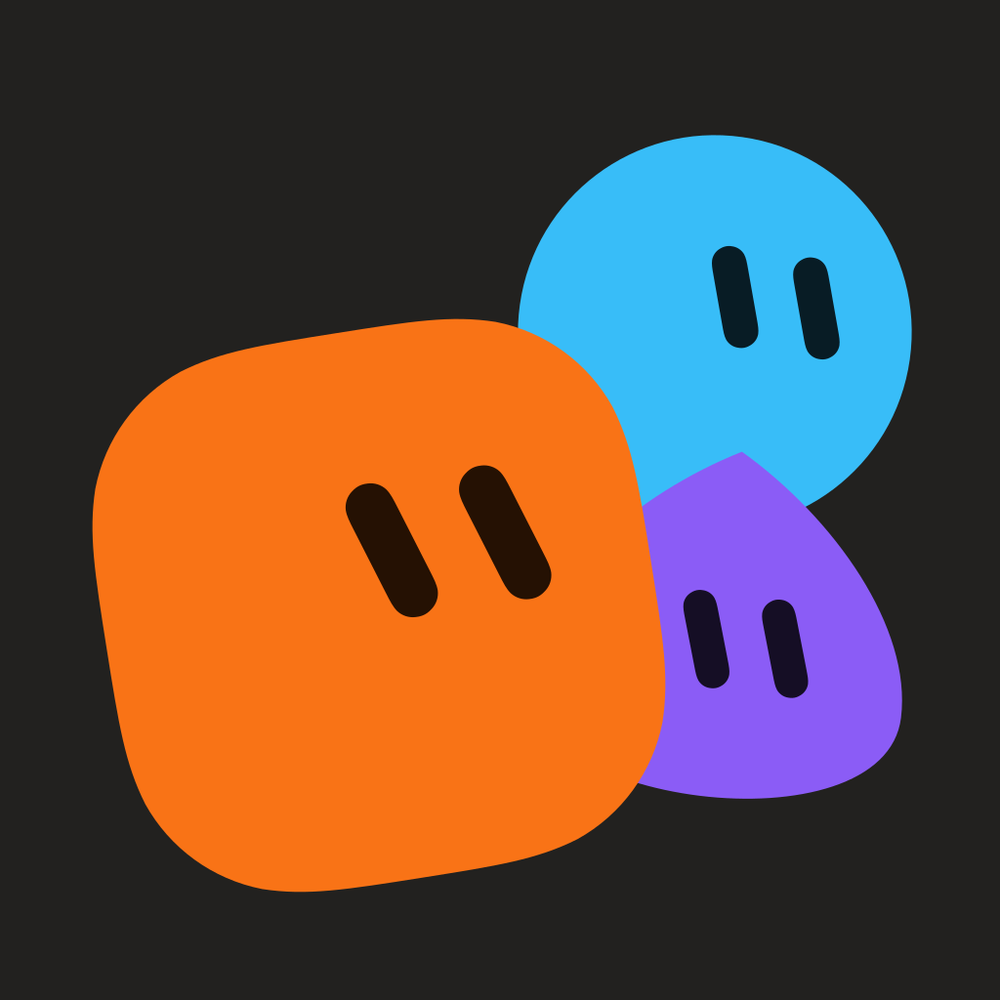
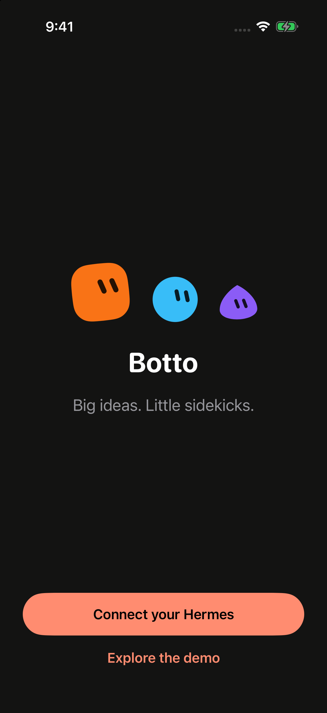
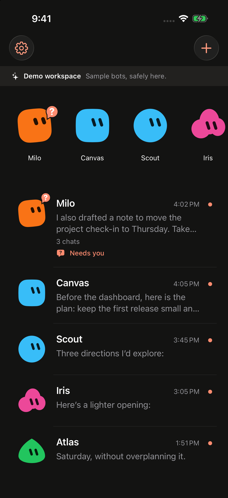
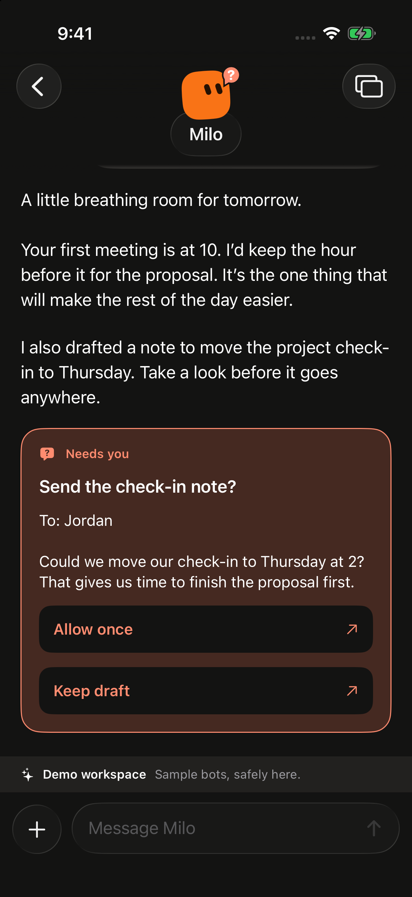

# Botto

Botto is a simple native iPhone and iPad app for your Hermes bots.

[](https://github.com/sreejithraman/Botto/actions/workflows/ios.yml)

<p>
  
  
  
</p>

**Big ideas. Little sidekicks.**

Chat with your bots, follow their work, and answer requests from your phone.
Keep separate chats and drafts, attach photos and files, and preview what your
bots create. Your Hermes host runs the work. Botto connects directly to it.

Optional [encrypted push notifications](docs/push-notifications.md) are
experimental. They require an unreleased Hermes observer patch, a configured
relay, and Apple provisioning. Signed physical-device delivery remains unverified.

## Try it

1. Open `Botto.xcodeproj` in Xcode and select the **Botto** scheme.
2. Choose an iPhone or iPad Simulator and run.
3. Choose **Explore the demo** to try sample bots without a server, or
   **Connect your Hermes** to use your own bots.

Botto supports iOS and iPadOS 18 or later. Building requires Xcode 27.1 or later
with an installed iOS Simulator runtime. Physical-device builds require your
own app and extension identifiers, signing team, Push Notifications provisioning,
and shared Keychain configuration. See [build and signing](docs/setup.md#build-and-signing).

[Connection setup](docs/setup.md) covers Hermes compatibility, sign-in, QR codes,
and host reachability. [Rich replies and files](docs/rich-content.md) explains
previews and supported formats. Demo content stays in a separate sample workspace.

## Development

The Xcode project is checked in. You only need XcodeGen when changing
[project.yml](project.yml).

Debug and Internal builds include **Settings → Developer menu** with avatar and
haptics playgrounds. Use the **Botto Internal** scheme for internal TestFlight;
public Release builds exclude these tools. See [developer tools](docs/developer-tools.md).

```sh
./scripts/check-core.sh
```

This runs the Swift package tests and a MainActor compatibility build.
See [Contributing](CONTRIBUTING.md) for native tests, CI, and the full UI and
file-export checks. [Verification results](docs/verification.md) record what
has actually been tested and the remaining limits.

## Thanks to Hermex

Botto owes a great deal to [Hermex](https://github.com/uzairansaruzi/hermex),
by Uzair Ansar. Its design and implementation shaped this project, and parts of
Botto adapt Hermex code. Thank you for sharing that work openly.

Botto is an independent client for [Hermes Agent](https://github.com/NousResearch/hermes-agent),
by Nous Research. See [Third-party notices](THIRD_PARTY_NOTICES.md) and the
bundled [licenses](LICENSES/) for attribution and license terms.

## License

Botto is licensed under the [MIT License](LICENSE). Third-party code retains
its own notices and license terms.

See the [changelog](CHANGELOG.md) for release notes and
[verification status](docs/verification.md) for tested platforms and known limits.

For bugs and changes, see [Contributing](CONTRIBUTING.md).
For sensitive reports, see [Security](SECURITY.md).
