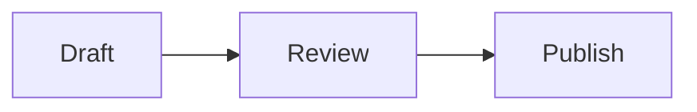

# Rich replies and files

Choose **Explore the demo**, then open the pinned **Canvas** bot. It includes
an interactive HTML dashboard, a Mermaid flowchart, an SVG illustration, plain
code, and downloadable PDF, text, image, and HTML samples. No server or special
launch argument is needed. The files and interactions stay on the device until
you choose Save or Share.

The last Canvas example loads an interactive three-bar visual from an HTML file
using the same `::preview` directive as Hermes Desktop.

Rendering and file-access rationale: [isolated assistant content](adr/0004-isolated-rich-content.md)
and [durable identity and live access](adr/0003-durable-identity-live-access.md).

## Inline previews

Bot replies keep native text before, between, and after previews. Complete
fenced blocks labelled `html`, `htm`, `mermaid`, or `svg` become previews:

````text
Here is the plan.



The next step is a short review.
````

Bot replies also support a standalone file directive:

```text
::preview{file="/path/on/hermes/report.html" height="360"}
```

Botto waits until the conversation is idle, then downloads the file through its original
connection, profile, and stored conversation. Relative paths resolve on the
Hermes host against that session's working folder. `.html`, `.htm`, and `.xhtml`
files render in the same isolated WebKit preview as HTML fences, with native
Source and Expand controls. The optional height supplies a bounded starting
size; measured content determines the rendered height. An original-file card
stays available for native preview, Save, and Share. Other file types become
file cards. Missing, empty, non-UTF-8, and oversized HTML show an error with a
retry and the original-file card. Examples inside code and malformed directives
stay source. User, tool, and system messages never load a directive.
File previews can reload after new work finishes. A queued follow-up never
counts as proof that the current HTML file has finished writing.

Changing the reply or retiring its conversation cancels pending reads and live
renderers. Returning to the same text cannot revive a retired download. HTML
must be self-contained; sibling assets and remote resources do not load.

The file ownership and download behavior follows
[Hermex's native chat attachment loader](https://github.com/uzairansaruzi/hermex/blob/4494746c7484221589189121c972ae54b336fac7/HermesMobile/Features/Chat/HermesChatTurnCoordinator.swift).
The directive and settled-turn rendering behavior follows
[Hermes Desktop's inline preview](https://github.com/NousResearch/hermes-agent/blob/75f8bd95fe73d01a11aa63a85880c404060ffbbb/apps/desktop/src/components/assistant-ui/inline-preview-directive.tsx).
Botto uses SwiftUI controls and its existing WebKit sandbox; it does not expose
Desktop's widget-to-composer bridge.

Use **Source** to read the original code or **Expand** for a larger view. User
messages keep chat bubbles. User, tool, and system messages never execute rich
content. Ordinary code and incomplete streaming fences stay selectable source.

Mermaid and SVG display as static diagrams. Use **Zoom diagram** or pinch to
enlarge, pan to read, and **Fit diagram** to return to the whole diagram. At fit
size, swipes scroll the conversation. Enlarged diagrams can look soft; very dense
diagrams or tiny labels can lose detail. Source keeps the original code.
SVG animation and JavaScript stop after rendering. Use HTML for interactive
content.

Rendered diagrams stay in a bounded memory cache for the current chat
presentation. Scrolling through a long reply can recycle native rows without
losing their matching images or measured height. New source, width, appearance,
or motion settings require matching pixels; reopening a chat or changing its
workspace starts a fresh presentation. Memory pressure and capacity eviction can
also require rendering again. HTML documents are not cached or pre-rendered.

The cache accounts for up to 16 MiB of decoded images and capture reservations,
with at most 12 charged objects and two pending static renders. Each image is
limited to 4 MiB and 1024 pixels on its longest axis. Images still held by native
views remain charged after lookup eviction. These bounds cover managed diagram
storage, not all WebKit, graphics or app memory. When capacity is busy, source
stays available while rendering waits; HTML has no new shared render cap.

HTML supports self-contained styles and local inline JavaScript. Each preview
has an isolated, temporary WebKit environment. It has no Hermes credentials,
shared browser storage, native app bridge, file access, or network access.
Remote scripts, images, fonts, forms, links, and extra diagram engines cannot
load. A failed or oversized preview leaves its source readable.

HTML and SVG previews accept up to 128 KiB of UTF-8 source. Mermaid accepts
16 KiB. Flowcharts and agentflows allow at most 100 edges; all diagram types
also have source, output-size, and execution limits. Larger source blocks stay
native code; other rendering errors leave Source available.

**Pele 1.9.0** is the single Mermaid renderer, bundled offline. It supports
Mermaid 12.1 built-in diagram types, including mindmaps and architecture, with
its own layout and Botto's colors. External plugins, arbitrary HTML labels,
JavaScript click callbacks, and Mermaid themes are unsupported. No math or
custom icon provider loads; TeX labels remain source. See
[third-party notices](../THIRD_PARTY_NOTICES.md).

## File previews

The **Artifacts** tab gathers delivered files, explicit terminal deliveries,
structured generation results,
and complete HTML, SVG, and Mermaid previews across chats. **Filter** limits the
list by bot or file type. **Include references** also shows user-supplied files
and local file links without an explicit delivery signal. Ordinary web links,
generic tool logs, and code examples do not become outputs. An output can be an
existing file the bot deliberately shared; the label does not prove authorship.

Tap an artifact to preview, Save, or Share without switching the selected chat.
The reader identifies its bot and chat; **Open chat** goes to that exact chat.
The separate **Search** tab finds bots, chat titles, message text, and artifacts
in available history. Search and library reads never mark a chat read. Partial
or unavailable history has a visible warning; pull to refresh retries reads.
Botto retains a bounded local index, inline source, downloaded originals, and
thumbnails across launches. Accepted chat updates feed that index without a
separate history scan. An offline relaunch shows retained content; it does not
claim a complete host library. Live updates omit unsettled assistant tails
from the disk index until completion. Device storage pressure can evict captures.

Ordinary browsing checks the chat directory and reuses complete history when
its tip, message count, timestamp, and exact preview are unchanged. Summaries
missing that evidence require a newest-page check; reused older history carries
a freshness warning. Pull to refresh checks history again. Partial history
remains partial and cannot certify an unchanged complete result.

Previewing a captured file reuses its original bytes, including offline.
**Reload from Bot** explicitly downloads the current host file; failure keeps
the previous capture visible. Save and Share wait for Reload to finish, and an
active export keeps its captured copy. A new producing message or source revision gets
a separate capture. A host path alone does not identify immutable contents.
The cache stays within its saved connection, installation, profile, and chat;
confirmed Forget removes that connection's captures. Cached identity never
grants network access. See [artifact capture scope](adr/0009-scoped-artifact-captures.md).

Tap a file card in either a user message or a bot reply to preview its captured
copy or download it from its originating Hermes conversation. Historical cards
keep their own producing occurrence, even when a later reply reuses the path.
Botto recognizes explicit Hermes `MEDIA:` and
`@file:` references, local `file://` links, and Markdown links to explicit server
paths. Ordinary web links and code examples remain text. Host paths identify
files on Hermes; they never open as local iPhone paths.

The retained file reader appears beside its conversation when space permits,
or fills the detail area in narrow space. **Full screen** and **Exit full screen** change
its allocation; **Close** ends the preview. Browsing Bots hides the reader.
Selecting a bot retires the old reader, including when selecting the same bot.

Plain text uses a selectable, read-only native text view with strict decoding.
PDF, images and other supported formats use Quick Look. The local **Actions**
menu offers **Save to Files** and **Share** for the original downloaded bytes,
including when text cannot be decoded or a format cannot be previewed. Files
larger than 25 MiB cannot load. Missing files and connection failures show an
error and a read-only retry.

The file tap captures its connection, profile, and conversation. Switching
connections or conversations retires that preview and cancels its pending
download. Retry never targets a replacement workspace. Temporary preview files
remain private and live only as long as their preview or export readers need
them.

Native download and Quick Look behavior adapts Hermex's iOS implementation.
The inline HTML, Mermaid, and SVG renderer is a separate Botto feature.
